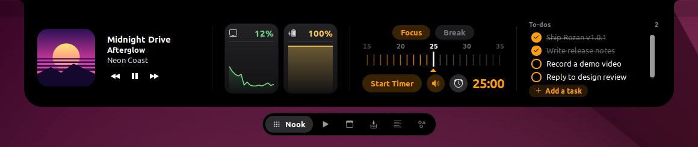

# Rozan

*Rozan* (روزن) is a **free, open-source notch for GNOME on Linux**, inspired by NotchNook for macOS. In Persian, a rozan is
the small opening high in a wall that lets light in. Rozan is a black pill at the top center of your screen that shows
what's happening right now: the song playing, a meeting about to start, a download, or what Claude Code is doing. Hover
over it and it opens into a small control center with music, calendar, a focus timer, to-dos, a file tray, a teleprompter
and Claude Code approvals.

Website: <https://hastashakiba.github.io/rozan/>

> **Unofficial.** Rozan is an independent project. It is not affiliated with or endorsed by the makers of NotchNook,
> and it doesn't include any NotchNook code or assets.



## Requirements

* GNOME Shell **42** (Ubuntu 22.04) in a **Wayland** session.
* `curl`, to download album art.
* Python 3, only if you use the Claude Code hook.

## Install

**From a release.** Download `rozan-<version>.zip` from
[Releases](https://github.com/HAstaShakiba/rozan/releases/latest), then run:

```bash
mkdir -p ~/.local/share/gnome-shell/extensions/rozan@hastashakiba.github.io
unzip rozan-*.zip -d ~/.local/share/gnome-shell/extensions/rozan@hastashakiba.github.io
```

**From source.** The repository root is the extension, so you can link a clone into place and update it with `git pull`:

```bash
git clone https://github.com/HAstaShakiba/rozan.git
ln -s "$PWD/rozan" ~/.local/share/gnome-shell/extensions/rozan@hastashakiba.github.io
```

On Wayland, GNOME Shell only looks for new extensions at login. Log out, log back in, and run:

```bash
gnome-extensions enable rozan@hastashakiba.github.io
```

### Upgrading from 1.0.x

Before 1.1.0, the extension was called `linux-notch@local`. To switch over and keep your to-dos, timer settings and
scripts:

```bash
gnome-extensions disable linux-notch@local
rm -rf ~/.local/share/gnome-shell/extensions/linux-notch@local
mv ~/.local/share/linux-notch ~/.local/share/rozan
```

Then install as above. If you use the Claude Code hook, update its path in `~/.claude/settings.json`.

## Use

| Gesture | Action |
|---|---|
| Hover, click, or scroll down on the notch | Open it |
| Click outside, or scroll up | Close it |
| Scroll sideways on the notch | Next or previous track |
| Click a tab in the tab pill | Switch workspace |
| Right-click the tab pill | Switch between **Classic** (black) and **Liquid Glass** (blurred, translucent) |

The notch hides when a window is fullscreen. It covers the center of the top bar, including the date menu; the closed
notch shows the time instead.

### Live activities

When it's closed, the notch shows one thing at a time, in this order of priority:

1. **Volume and brightness**, in place of GNOME's popup. GNOME's own popup is still used for fullscreen windows and
   while the notch is open. Also shown here: the charger being plugged in or unplugged, low battery (20, 10 and 5 %),
   and a finished download.
2. **Claude Code** waiting for your approval.
3. **The Focus/Break timer**, while it runs.
4. **A meeting** starting within 10 minutes ("in N min"), or one that started less than 5 minutes ago ("now").
5. **A download** in progress in `~/Downloads` (Firefox `.part`, Chromium `.crdownload` and similar), with its size so far.
6. **Claude Code** working on a step.
7. **Music**, with album art and an equalizer.
8. **The clock.**

### Workspaces

| | |
|---|---|
| **Nook** | Mini player with the app's icon on the art. CPU and battery tiles with history charts (a memory tile on machines without a battery). A Focus/Break timer: scroll or drag the minute ruler, then Start. It plays an alarm and shows a notification when a period ends. To-dos: click to tick, right-click to delete, *Add a task* to add (Enter adds, Esc cancels). |
| **Music** | Works with any MPRIS player (Spotify, Firefox, Chromium, VLC and others). Shows art, title and artist, with a progress bar you can drag to seek, and previous, play/pause and next. |
| **Calendar** | Today's remaining events and tomorrow's, from GNOME's calendar server, so GNOME Online Accounts and Evolution calendars are included. An event in progress is marked *Now*. |
| **Tray** | A shelf of files. GNOME Shell 42 can't receive drag-and-drop from Wayland apps, so copy files in Files (Ctrl+C) and press **Paste**. Click a file to open it; right-click to open, copy, show in Files or remove it. |
| **Prompter** | A teleprompter for `.txt` scripts in `~/.local/share/rozan/scripts` (*Edit scripts…* opens the folder). It has a 3-second countdown, speed and text size controls, and the mouse wheel jumps through the text. The lock keeps the notch open. Voice mode is shown but disabled, because GNOME has no speech recognition service. |
| **Agents** | Claude Code progress: the current prompt, the task list or recent steps, and the running command with its elapsed time. Allow or deny permission requests, or jump to the terminal. Each session gets a chip at the top of the page: green while working, orange while waiting for approval. Sessions whose terminal was closed disappear within about 10 seconds. |

## Claude Code hook

The Agents workspace is fed by `hooks/notch-hook.py`. To use it, add the hook to `~/.claude/settings.json`, replacing
`/path/to/rozan` with the folder where the extension is installed:

```json
{
  "hooks": {
    "SessionStart":       [{"hooks": [{"type": "command", "command": "/path/to/rozan/hooks/notch-hook.py"}]}],
    "UserPromptSubmit":   [{"hooks": [{"type": "command", "command": "/path/to/rozan/hooks/notch-hook.py"}]}],
    "PreToolUse":         [{"matcher": "*", "hooks": [{"type": "command", "command": "/path/to/rozan/hooks/notch-hook.py"}]}],
    "PostToolUse":        [{"matcher": "*", "hooks": [{"type": "command", "command": "/path/to/rozan/hooks/notch-hook.py"}]}],
    "PostToolUseFailure": [{"matcher": "*", "hooks": [{"type": "command", "command": "/path/to/rozan/hooks/notch-hook.py"}]}],
    "PermissionRequest":  [{"matcher": "*", "hooks": [{"type": "command", "command": "/path/to/rozan/hooks/notch-hook.py", "timeout": 90}]}],
    "TaskCreated":        [{"hooks": [{"type": "command", "command": "/path/to/rozan/hooks/notch-hook.py"}]}],
    "TaskCompleted":      [{"hooks": [{"type": "command", "command": "/path/to/rozan/hooks/notch-hook.py"}]}],
    "Stop":               [{"hooks": [{"type": "command", "command": "/path/to/rozan/hooks/notch-hook.py"}]}],
    "SessionEnd":         [{"hooks": [{"type": "command", "command": "/path/to/rozan/hooks/notch-hook.py"}]}]
  }
}
```

A permission request waits up to 60 seconds for an answer in the notch, then falls back to the normal terminal prompt.
The hook only waits while Rozan is running, so Claude Code behaves as usual when the extension is off. The terminal
button raises the window running the session. For ddterm it opens the drop-down, but it can't pick the tab.

## Where things are stored

| Path | Contents |
|---|---|
| `~/.local/share/rozan/state.json` | To-dos, timer settings and the chosen look |
| `~/.local/share/rozan/scripts/` | Prompter scripts |
| `~/.cache/rozan/art/` | Album art cache |
| `~/.cache/rozan/agents/` | One file per Claude Code session, written by the hook |

## Development

Wayland can't restart GNOME Shell in place, so after changing code you have to log out and back in. To try changes
without logging out, run a nested shell:

```bash
dbus-run-session -- gnome-shell --nested --wayland
# in the nested window:
gnome-extensions enable rozan@hastashakiba.github.io
```

To watch the logs:

```bash
journalctl --user -f -o cat /usr/bin/gnome-shell | grep -iE 'rozan|error'
```

| File | What it does |
|---|---|
| `extension.js` | Enable/disable entry point |
| `notch.js` | The notch actor, expanding and collapsing, gestures, live activities, Music page, Liquid Glass |
| `nook.js`, `timer.js`, `sysmon.js` | Nook page, Focus/Break timer, CPU/memory/battery sampling |
| `mpris.js`, `art.js` | MPRIS player discovery, album art cache (downloaded with curl) |
| `calendar.js` | Calendar feed (GNOME Shell's `DBusEventSource`) and the Calendar page |
| `battery.js`, `downloads.js` | UPower battery monitor, `~/Downloads` monitor |
| `tray.js`, `prompter.js`, `agents.js` | Tray, Prompter and Agents pages |
| `store.js` | JSON state file |
| `hooks/notch-hook.py` | Claude Code hook that feeds the Agents page |
| `stylesheet.css` | Styles |
| `site/` | The website, published to GitHub Pages by `.github/workflows/pages.yml` |

## Uninstall

```bash
gnome-extensions disable rozan@hastashakiba.github.io
rm -rf ~/.local/share/gnome-shell/extensions/rozan@hastashakiba.github.io
rm -rf ~/.local/share/rozan ~/.cache/rozan   # optional: your to-dos and settings
```

If you added the Claude Code hook, remove it from `~/.claude/settings.json` too.

## License

MIT. See [LICENSE](LICENSE).
